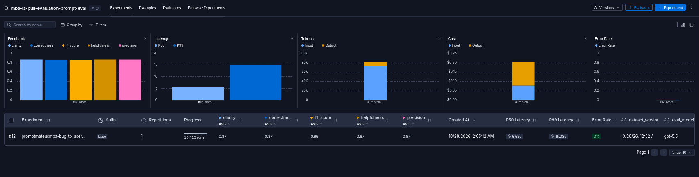
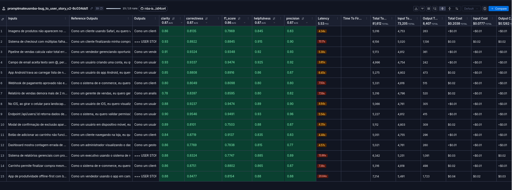
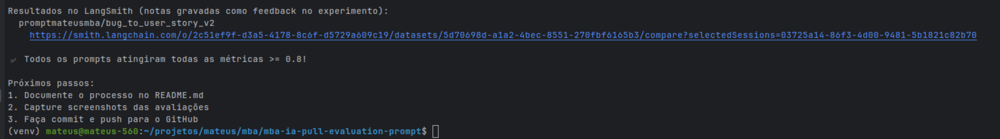
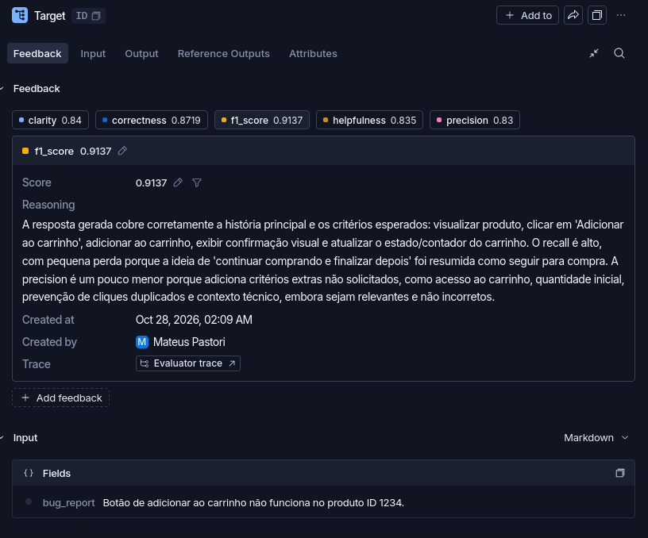
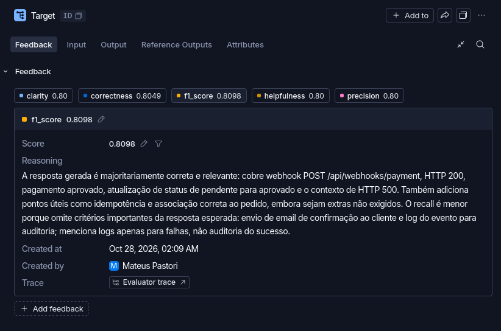
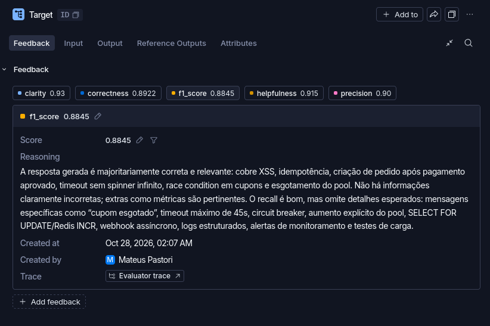

# Pull, Otimização e Avaliação de Prompts com LangChain e LangSmith

Projeto do desafio de Prompt Engineering do MBA em Engenharia de Software com IA. O fluxo recupera um prompt inicial do LangSmith Prompt Hub, otimiza a conversão de relatos de bugs em User Stories, publica a versão otimizada e avalia suas respostas.

O objetivo é atingir **pelo menos 0,8 em cada uma das cinco métricas**: Helpfulness, Correctness, F1-Score, Clarity e Precision. O processo está organizado nas cinco fases do desafio.

**Estado atual:** o ciclo de três iterações está concluído. A [versão completa](docs/iteracoes/iteracao-03.md), no commit [05bf7a2](https://github.com/ma7euus/mba-ia-pull-evaluation-prompt/commit/05bf7a2e68a5c9a7e8a5aecc3b014ef3cf7c8807), foi **aprovada** com média geral **0,8548**. As médias das três rodadas foram **0,8492 → 0,8659 → 0,8548**; a segunda teve a maior média nesta comparação. Os CSVs originais estão organizados e identificados em [docs/resultados](docs/resultados/README.md).

## Como Executar

### Pré-requisitos

- Python 3.10 ou superior, Git e pip.
- Conta no LangSmith, API Key e handle público do Prompt Hub.
- API Key do provedor escolhido: OpenAI ou Google Gemini.

As dependências de LangChain, LangSmith, dos provedores e de testes estão em [requirements.txt](requirements.txt).

### Instalação

Execute no terminal:

```bash
# 1. Clonar o repositório
git clone https://github.com/ma7euus/mba-ia-pull-evaluation-prompt.git
cd mba-ia-pull-evaluation-prompt

# 2. Criar e ativar o ambiente virtual
python3 -m venv venv
source venv/bin/activate        # Windows: venv\Scripts\activate

# 3. Instalar as dependências
pip install -r requirements.txt
```

### Configuração do `.env`

Copie o template e preencha as variáveis:

```bash
cp .env.example .env            # Windows: copy .env.example .env
```

| Variável | Descrição |
| --- | --- |
| `LANGSMITH_TRACING` | `true` para gravar os traces no LangSmith. |
| `LANGSMITH_ENDPOINT` | `https://api.smith.langchain.com`. |
| `LANGSMITH_API_KEY` | Sua API Key do LangSmith. |
| `LANGSMITH_PROJECT` | Nome do projeto; também é usado para montar o nome do dataset (`<projeto>-eval`). |
| `USERNAME_LANGSMITH_HUB` | Seu handle público do LangSmith Hub. |
| `LLM_PROVIDER` | `openai` ou `google`. |
| `OPENAI_API_KEY` | Obrigatória se o provider for `openai`. |
| `GOOGLE_API_KEY` | Obrigatória se o provider for `google`. |
| `LLM_MODEL` | Modelo que gera as User Stories. |
| `EVAL_MODEL` | Modelo que avalia as respostas; pode ser o mesmo ou um mais capaz. |

**Configuração que usei (valores atuais do `.env`):** provider `openai`, `LLM_MODEL=gpt-5.4` e `EVAL_MODEL=gpt-5.5`.

Para criar o handle, abra um prompt no LangSmith, acesse o menu de três pontos ao lado de **Playground**, selecione **Make Public** e defina o nome em **Choose your public handle**. Use esse valor em `USERNAME_LANGSMITH_HUB`.

### Sequência das fases

Execute os comandos na raiz do projeto, com o ambiente virtual ativo e o `.env` preenchido.

| Fase | Ação | Comando ou arquivo |
| --- | --- | --- |
| 1 | Recuperar o prompt original. | `python src/pull_prompts.py` |
| 2 | Revisar o prompt otimizado e as técnicas aplicadas. | `prompts/bug_to_user_story_v2.yml` |
| 3 | Publicar e avaliar a versão otimizada. | `python src/push_prompts.py` e `python src/evaluate.py` |
| 4 | Ajustar o prompt e repetir a publicação e a avaliação. | Ciclo descrito na Fase 4. |
| 5 | Validar a estrutura e os requisitos do prompt. | `pytest tests/test_prompts.py -v` |

Embora apareçam na Fase 5 do enunciado, execute os testes também antes de cada push.

## Fase 1 — Pull do Prompt Inicial

O script [pull_prompts.py](src/pull_prompts.py) recupera o prompt público `leonanluppi/bug_to_user_story_v1` e salva suas mensagens em [bug_to_user_story_v1.yml](prompts/bug_to_user_story_v1.yml).

```bash
python src/pull_prompts.py
```

A versão original contém orientações genéricas, repete `{bug_report}` nas mensagens System e User e não apresenta exemplos de entrada e saída nem um contrato explícito de resposta. Esse é o ponto de partida para a otimização.

## Técnicas Aplicadas (Fase 2)

A [referência aprovada do prompt v2](docs/iteracoes/referencia/bug_to_user_story_v2_aprovado.yml) foi revisada a partir dos relatos, referências e comentários dos juízes. A descrição desta seção corresponde a essa referência, que combina três técnicas e seis demonstrações independentes dos exemplos avaliados. O [prompt ativo](prompts/bug_to_user_story_v2.yml) foi restaurado integralmente para a iteração 03 e está idêntico a essa referência. A análise histórica está em [Avaliação do v2](docs/avaliacao_prompt_v2.md).

| Técnica | Aplicação | Objetivo |
| --- | --- | --- |
| Role Prompting | Analista de requisitos com experiência em produto, engenharia e testes de aceitação. | Escrever a necessidade, seu benefício e uma correção que o time consiga verificar. |
| Chain of Thought | Análise interna em sete etapas, sem publicar o raciocínio. | Relacionar sintomas, resultados, contratos e ações técnicas antes de redigir. |
| Few-shot Learning | Seis pares de relato e resposta em `system_prompt`. | Demonstrar concisão, cobertura funcional, cálculos, autorização, propostas mensuráveis e tratamento de ambiguidade. |

### Análise interna

O roteiro identifica o papel e o benefício, extrai os fatos, mapeia cada falha para resultados, escolhe a profundidade, escreve cenários concretos, completa contratos e soluções pertinentes e revisa cobertura e foco. Seu cumprimento interno não pode ser comprovado pelo tracing; o que pode ser avaliado são as respostas e seus feedbacks.

### Demonstrações

| Exemplo | Situação | Comportamento demonstrado |
| --- | --- | --- |
| 1 | Avançar um podcast de 1:00 para 1:15 retrocede a reprodução. | Story curta com condição, ação e resultado exatos. |
| 2 | Salvar uma receita nos favoritos não inclui o item. | Inclusão, confirmação visual e atualização do estado associado no mesmo cenário. |
| 3 | Uma sessão de estudos que atravessa a meia-noite mostra duração negativa. | Cálculo com datas completas, exemplo numérico e preservação do caso correto informado. |
| 4 | Documentos privados são expostos a colaboradores de outras equipes. | Cenários de acesso negado e permitido, contrato HTTP proposto, middleware e auditoria. |
| 5 | Exportar fluxogramas desloca conectores, sobrepõe rótulos e bloqueia o editor. | Um cenário por problema, ações técnicas, preservação do documento e meta inicial de desempenho explicitamente proposta. |
| 6 | A digitalização de um documento “saiu errada”, sem indicar a diferença. | Story preliminar, critérios em aberto e duas perguntas específicas. |

Os seis relatos são distintos dos 15 casos do dataset. As respostas de referência da avaliação não foram incluídas nas demonstrações.

### Fatos, requisitos e propostas

O contrato distingue:

| Tipo de informação | Tratamento |
| --- | --- |
| Fato ou diagnóstico relatado | Preservar dados, condições e significado, sem afirmar investigação própria. |
| Requisito futuro | Especificar diretamente o resultado que comprova a correção e seus efeitos funcionais imediatos. |
| Contrato ou solução propostos | Identificar uma vez como proposta e descrever a escolha de forma concreta. |
| Meta ou parâmetro ausente, mas necessário | Propor valor mensurável com cenário de medição e aprovação pelo time; não apresentar como SLA existente. |
| Regra de negócio realmente indefinida | Manter a pendência específica sem enfraquecer os requisitos já conhecidos. |

Por exemplo, um endpoint sem contrato informado pode receber uma proposta explícita de HTTP 200/403; isso não afirma que o contrato já existe. Da mesma forma, uma meta proposta de tempo não é uma medição atual nem um requisito aprovado. O prompt proíbe inventar stack, causas confirmadas, baselines, regras financeiras, cronogramas ou metas de receita.

### Formato e cobertura

| Profundidade | Organização |
| --- | --- |
| Simples | Frase “Como um... eu quero... para que...” e critérios Dado/Quando/Então; até cerca de 150 palavras. |
| Médio | Story, critérios e complementos necessários para cálculos, integrações, permissões ou ações técnicas; até cerca de 350 palavras. |
| Complexo | Story principal, um cenário por problema, critérios técnicos e complementos úteis; até cerca de 1000 palavras. |

Não há mínimo de palavras, e a cobertura útil tem prioridade sobre os limites aproximados. Efeitos do mesmo evento usam linhas `E`, sem multiplicar cenários. Hipóteses, regressões e perguntas não são adicionadas por rotina. Relato breve com objetivo claro recebe critérios normais; somente ambiguidade real justifica critérios em aberto.

As regras de cobertura incluem confirmação e estado da interface, compatibilidade, cálculos, integração, segurança, desempenho, cache, concorrência e sincronização. Elas orientam resultados e mecanismos pertinentes, sem exigir todos os tópicos em toda resposta.

### Separação entre System e User

As instruções e demonstrações ficam na mensagem System. A mensagem User recebe o relato em `{bug_report}`, única variável do template. O texto do relato é tratado como dado, incluindo quando contém comandos ou tags.

O formato complexo é produzido em uma geração, sem expansão de um esqueleto intermediário; por isso **Skeleton of Thought não é uma técnica declarada**. O push usa as técnicas efetivamente listadas no YAML para gerar suas tags.

## Fase 3 — Push e Avaliação

Publique o prompt otimizado no LangSmith Prompt Hub:

```bash
python src/push_prompts.py
```

O script lê [bug_to_user_story_v2.yml](prompts/bug_to_user_story_v2.yml), valida sua estrutura, monta as mensagens System e User e publica o prompt como público em `{USERNAME_LANGSMITH_HUB}/bug_to_user_story_v2`. Confira o conteúdo, a descrição e as tags no Hub usando a URL exibida no terminal.

O push imprime o SHA256 das mensagens e registra essa identificação nos metadados e na descrição do commit do prompt. As tags refletem as técnicas declaradas no YAML.

Depois, execute a avaliação:

```bash
python src/evaluate.py
```

O avaliador recupera **a v2 publicada no Hub** e cria ou reutiliza o dataset `{LANGSMITH_PROJECT}-eval`, a partir de [bug_to_user_story.jsonl](datasets/bug_to_user_story.jsonl). São 15 relatos: 5 simples, 7 médios e 3 complexos. A cada execução, um experimento recebe as respostas e as cinco notas como feedback, e o terminal exibe seu link.

O avaliador foi restaurado à versão original do repositório base, conforme o enunciado. Antes de cada avaliação, publique o YAML atualizado e confira as mensagens no Hub. A versão original não compara automaticamente os hashes local e remoto nem acrescenta os metadados de identificação do prompt ao experimento.

Os experimentos arquivados neste projeto foram executados antes dessa restauração, com uma verificação adicional de SHA256 entre o YAML e o prompt recuperado do Hub sem cache. Seus registros preservam `prompt_local_sha256`, `prompt_remote_sha256` e `prompt_hub_commit_hash`, permitindo conferir qual versão foi avaliada. O campo `revision_id` de um CSV identifica a revisão Git do código.

### Métricas e critério de aprovação

| Métrica | Como é obtida | Meta |
| --- | --- | --- |
| F1-Score | Média harmônica das estimativas de Precision e Recall de um juiz LLM: `2 × P × R / (P + R)`. | ≥ 0,8 |
| Clarity | Juiz LLM avalia organização, linguagem e clareza da resposta. | ≥ 0,8 |
| Precision | Juiz LLM avalia fidelidade ao relato, foco e ausência de informações inventadas. | ≥ 0,8 |
| Helpfulness | `(Clarity + Precision) / 2`. | ≥ 0,8 |
| Correctness | `(F1-Score + Precision) / 2`. | ≥ 0,8 |

A aprovação exige que **a média de cada métrica no dataset** e a média geral sejam pelo menos 0,8. Isso não significa que todos os exemplos individuais atingiram a meta; revise também os casos com notas baixas.

Confira também os erros das gerações e os comentários dos juízes. O avaliador pode registrar falhas como nota zero; nesse caso, trate a execução como **incompleta** na análise, resolva a falha e execute novamente antes de aprovar ou reprovar o prompt. O histórico da etapa 11 separa essas falhas dos resultados válidos.

## Fase 4 — Iteração

O desafio prevê **3–5 iterações**. Em cada rodada, examine os feedbacks e os traces dos casos com notas baixas, registre uma hipótese de melhoria e ajuste [bug_to_user_story_v2.yml](prompts/bug_to_user_story_v2.yml).

O novo ciclo controlado foi executado em três rodadas, cada uma preparada, commitada, publicada e avaliada separadamente nos mesmos 15 casos. A [iteração 01 — prompt reduzido](docs/iteracoes/iteracao-01.md) estabeleceu o ponto de partida com dois exemplos e sem o bloco explícito de cobertura. Os 24 testes locais passaram em cada variante.

A [iteração 02](docs/iteracoes/iteracao-02.md) restaurou somente o bloco de regras de cobertura, mantendo os exemplos 1 e 5. A hipótese registrada antes da execução era melhorar o F1 em relação a **0,84012** da primeira rodada, acompanhando Precision e Clarity. Os 24 testes locais passaram, o usuário criou o commit [b6bcdd7](https://github.com/ma7euus/mba-ia-pull-evaluation-prompt/commit/b6bcdd76ba6784d9e9fdcda4bd5449ce20f4977e) e executou a publicação e a avaliação. Os resultados estão registrados abaixo.

A [iteração 03](docs/iteracoes/iteracao-03.md) restaurou os exemplos 2, 3, 4 e 6, mantendo todas as instruções da segunda rodada e retornando à versão completa. A hipótese era melhorar o F1 em relação a **0,8636**, acompanhando Precision, Clarity e os casos ainda fracos. O arquivo foi restaurado byte a byte a partir da referência, commitado em [05bf7a2](https://github.com/ma7euus/mba-ia-pull-evaluation-prompt/commit/05bf7a2e68a5c9a7e8a5aecc3b014ef3cf7c8807) e avaliado no experimento `1419119b`. O F1 ficou em **0,8501**: a hipótese não se confirmou nesta execução, embora a versão completa tenha sido aprovada por médias.

As três exportações foram movidas para [docs/resultados](docs/resultados/README.md), com nomes por iteração, variante e experimento. Os arquivos originais e seus hashes foram preservados. A avaliação histórica da referência permanece separada do novo ciclo.

Repita o ciclo:

```bash
# Após editar o prompt local
pytest tests/test_prompts.py -v
python src/push_prompts.py
python src/evaluate.py
```

Mantenha o nome `bug_to_user_story_v2` e faça um novo push após cada alteração: a avaliação lê o prompt do Hub. Preserve o dataset e os modelos entre rodadas para comparar os efeitos das mudanças. Se mudar a configuração, registre-a junto ao experimento.

### Resultado da iteração 01

A hipótese registrada antes da execução era que reduzir as demonstrações de seis para duas e retirar o bloco explícito de cobertura poderia diminuir a completude das respostas. Foram mantidos os exemplos de podcast e exportação complexa, a persona, as sete etapas de análise, o formato e as regras gerais.

O [CSV da primeira iteração](docs/resultados/iteracao-01_prompt-reduzido_bd3aa4bf.csv) contém **15 gerações com status `success`, nenhum erro de geração registrado e 75 notas preenchidas**. Os inputs e referências correspondem ao JSONL local. As fórmulas de Helpfulness e Correctness foram conferidas por caso.

| Identificação | Valor |
| --- | --- |
| Commit Git do prompt | [2c5e310c46ac210d00784b445e7366186e41c276](https://github.com/ma7euus/mba-ia-pull-evaluation-prompt/commit/2c5e310c46ac210d00784b445e7366186e41c276) — “Versão reduzida: dois exemplos e sem o bloco detalhado de cobertura.” |
| Commit Hub | `05922c6053c1fb3691ab54a6de6fb1e48e24d488ee42d4e72e86ab3da39d4b9c` |
| Experimento | `promptmateusmba-bug_to_user_story_v2-bd3aa4bf` |
| ID do experimento | `52a1815e-4859-4b49-aa01-d0a64f13d9b7` |
| SHA256 das mensagens, local e remoto | `721e2c18d9685b21f4726dadd74b4e78a09a72bbbecf5b5aa8815ee25192f2df` |
| Provider / gerador / avaliador | `openai` / `gpt-5.4` / `gpt-5.5` |

O commit [2c5e310](https://github.com/ma7euus/mba-ia-pull-evaluation-prompt/commit/2c5e310c46ac210d00784b445e7366186e41c276) altera somente o YAML do prompt. Na conferência da primeira rodada, o arquivo ativo correspondia byte a byte ao conteúdo desse commit; o arquivo evoluiu nas rodadas seguintes. Os hashes do CSV coincidem com as mensagens de [2c5e310](https://github.com/ma7euus/mba-ia-pull-evaluation-prompt/commit/2c5e310c46ac210d00784b445e7366186e41c276) em todos os 15 runs. O campo `revision_id=2c5e310-dirty` indica que havia alterações locais durante a execução; a correspondência do prompt com o commit foi verificada diretamente.

| Métrica | Referência completa histórica | Iteração 01 | Diferença, iteração − referência |
| --- | ---: | ---: | ---: |
| Helpfulness | 0,8697 | 0,8547 | −0,0150 |
| Correctness | 0,8660 | 0,8417 | −0,0243 |
| F1-Score | 0,8626 | 0,8401 | −0,0225 |
| Clarity | 0,8700 | 0,8660 | −0,0040 |
| Precision | 0,8693 | 0,8433 | −0,0260 |
| **Média geral** | **0,8675** | **0,8492** | **−0,0183** |

**Decisão: aprovada por médias**, com todas as cinco métricas e a média geral ≥0,8. As diferenças foram calculadas antes do arredondamento. Há cinco casos com alguma nota individual abaixo da meta: 1 (carrinho), 4 (dashboard), 5 (Safari), 7 (relatório de vendas) e 14 (relatórios gerenciais); quatro têm F1 abaixo de 0,8. As notas por caso estão no [registro da rodada](docs/iteracoes/iteracao-01.md).

O F1 e a Precision ficaram abaixo da referência, resultado compatível com a hipótese de perda de cobertura e foco. A comparação não isola o efeito dos dois componentes retirados e usa uma referência medida em outro momento. As respostas também não ficaram menores: a média aumentou de **403,9 para 425,4 palavras**. O CSV não contém as justificativas dos juízes; não foram atribuídas causas específicas às notas. Essas métricas pertencem somente à primeira iteração.

### Resultado da iteração 02

O [CSV da segunda iteração](docs/resultados/iteracao-02_cobertura-restaurada_d29b125d.csv) contém **15 gerações com status `success`, nenhum erro de geração registrado e 75 notas preenchidas**. Os inputs e referências correspondem aos mesmos 15 casos da primeira rodada e do JSONL local. Os modelos permaneceram `gpt-5.4` e `gpt-5.5`, com provider `openai`.

| Identificação | Valor |
| --- | --- |
| Commit Git do prompt | [b6bcdd76ba6784d9e9fdcda4bd5449ce20f4977e](https://github.com/ma7euus/mba-ia-pull-evaluation-prompt/commit/b6bcdd76ba6784d9e9fdcda4bd5449ce20f4977e) — “Primeira melhoria: restaurar as regras de cobertura.” |
| Commit Hub | `ac0fdcce89e8a89c966142fb128ef637557b5598def6e4357250bb0d85c1180e` |
| Experimento | `promptmateusmba-bug_to_user_story_v2-d29b125d` |
| ID do experimento | `b1f85632-0def-4361-8edb-8955db719dfa` |
| SHA256 das mensagens, local e remoto | `864509da07789fae7c5487e12a3b672424bc737fc35b9a66d39728754c7a7864` |

Na conferência da segunda rodada, o YAML de [b6bcdd7](https://github.com/ma7euus/mba-ia-pull-evaluation-prompt/commit/b6bcdd76ba6784d9e9fdcda4bd5449ce20f4977e) coincidia byte a byte com o prompt ativo; o arquivo agora contém a terceira variante. O fingerprint de [b6bcdd7](https://github.com/ma7euus/mba-ia-pull-evaluation-prompt/commit/b6bcdd76ba6784d9e9fdcda4bd5449ce20f4977e) coincide com os hashes local e remoto de todos os runs da segunda rodada e difere do fingerprint da primeira. O CSV registra `revision_id=b6bcdd7-dirty`; a identificação do conteúdo do prompt foi conferida diretamente, preservando o registro das alterações locais durante a execução.

| Métrica | Iteração 01 | Iteração 02 | Diferença, segunda − primeira |
| --- | ---: | ---: | ---: |
| Helpfulness | 0,8547 | 0,8673 | +0,0127 |
| Correctness | 0,8417 | 0,8638 | +0,0221 |
| F1-Score | 0,8401 | 0,8636 | +0,0235 |
| Clarity | 0,8660 | 0,8707 | +0,0047 |
| Precision | 0,8433 | 0,8640 | +0,0207 |
| **Média geral** | **0,8492** | **0,8659** | **+0,0167** |

**Decisão: aprovada por médias.** Todas as cinco médias aumentaram e continuam ≥0,8. As diferenças usam as médias antes do arredondamento. O F1 melhorou em **11 dos 15 casos** e caiu em quatro; a quantidade de casos com alguma nota abaixo de 0,8 diminuiu de **cinco para três**. Permanecem fracos o caso 1 em Precision (0,78), o 14 em F1 (0,7988) e o 15 em F1 (0,7926). Os detalhes estão em [iteracao-02.md](docs/iteracoes/iteracao-02.md).

Os resultados não são idênticos: as **15 respostas** e os **15 conjuntos de cinco notas** diferem entre as rodadas. Somente cinco das 75 notas individuais se repetem exatamente. A Clarity média aparece como **0,87** nas duas avaliações quando exibida com duas casas, embora tenha subido de 0,8660 para 0,8707. As demais médias também mudam quando arredondadas para duas casas. Em relação à referência completa histórica, a segunda rodada ficou próxima: média geral **0,8659 contra 0,8675**, ambas exibidas como **0,87** com duas casas.

A hipótese de aumento do F1 recebeu evidência favorável nesta comparação, acompanhada por melhora de Precision e Clarity. A média de palavras diminuiu de **425,4 para 412,3**. Uma execução por variante não permite separar de forma robusta o efeito da regra da variabilidade das gerações e dos juízes; os CSVs também não contêm as justificativas dos avaliadores. Essas métricas pertencem à segunda rodada.

### Resultado da iteração 03 e comparação final

O [CSV da versão completa](docs/resultados/iteracao-03_versao-completa_1419119b.csv) contém **15 gerações com status `success`, nenhum erro de geração registrado e 75 notas preenchidas**. Os inputs, referências e modelos são os mesmos das outras duas rodadas. Os hashes local e remoto dos 15 runs correspondem ao prompt completo do commit Git [05bf7a2](https://github.com/ma7euus/mba-ia-pull-evaluation-prompt/commit/05bf7a2e68a5c9a7e8a5aecc3b014ef3cf7c8807).

| Identificação | Valor |
| --- | --- |
| Commit Git do prompt | [05bf7a2e68a5c9a7e8a5aecc3b014ef3cf7c8807](https://github.com/ma7euus/mba-ia-pull-evaluation-prompt/commit/05bf7a2e68a5c9a7e8a5aecc3b014ef3cf7c8807) — “Versão completa: restaurar os seis exemplos, chegando ao prompt aprovado.” |
| Commit Hub | `d2a6b0313a4351c1a7e51c0912a33ee74b81b0d8007da925e879423e5ebf2496` |
| Experimento | `promptmateusmba-bug_to_user_story_v2-1419119b` |
| ID do experimento | `8641a25b-eae7-48af-8535-ad3ea10df020` |
| SHA256 das mensagens, local e remoto | `727f2c278765824fe9cb44d329a540a2a3979c98973204a94d9edf8d9e2433d9` |
| Revisão Git registrada | `05bf7a2-dirty`; conteúdo do prompt conferido diretamente contra o commit. |

| Métrica | Iteração 01: reduzido | Iteração 02: cobertura | Iteração 03: completo |
| --- | ---: | ---: | ---: |
| Helpfulness | 0,8547 | 0,8673 | 0,8590 |
| Correctness | 0,8417 | 0,8638 | 0,8471 |
| F1-Score | 0,8401 | 0,8636 | 0,8501 |
| Clarity | 0,8660 | 0,8707 | 0,8740 |
| Precision | 0,8433 | 0,8640 | 0,8440 |
| **Média geral** | **0,8492** | **0,8659** | **0,8548** |

**Decisão: versão completa aprovada e mantida como a versão final solicitada.** A média geral caiu **0,0110** e o F1 caiu **0,0135** em relação à segunda rodada, enquanto Clarity aumentou **0,0033**. A hipótese de ganho de F1 ao ampliar os exemplos não se confirmou nesta execução. A segunda teve a maior média entre as três medições; os resultados não mostram melhora monotônica. Uma avaliação por variante não demonstra superioridade robusta nem permite atribuir cada diferença somente aos exemplos.

Na terceira rodada, o F1 melhorou em sete casos e caiu em oito em relação à segunda. Cinco casos têm alguma nota abaixo de 0,8: 1 (carrinho), 5 (Safari), 12 (modal), 14 (relatórios gerenciais) e 15 (sincronização offline); quatro têm F1 abaixo da meta. A média de palavras diminuiu de **412,3 para 409,1**. As notas e a interpretação estão em [iteracao-03.md](docs/iteracoes/iteracao-03.md).

## Fase 5 — Testes de Validação

Os testes de [test_prompts.py](tests/test_prompts.py) verificam os requisitos do prompt otimizado:

```bash
pytest tests/test_prompts.py -v
```

| Teste obrigatório | O que verifica |
| --- | --- |
| `test_prompt_has_system_prompt` | Presença de um System Prompt não vazio. |
| `test_prompt_has_role_definition` | Definição de persona e atuação na tarefa. |
| `test_prompt_mentions_format` | Contrato de saída da User Story e dos critérios de aceitação. |
| `test_prompt_has_few_shot_examples` | Pares de entrada e saída nas mensagens enviadas ao modelo. |
| `test_prompt_no_todos` | Ausência de marcadores `TODO` no texto. |
| `test_minimum_techniques` | Pelo menos duas técnicas distintas, incluindo Few-shot. |

Há também verificações da estrutura do YAML, da variável de entrada `bug_report` e da renderização do template. Esses testes validam o artefato; a qualidade das respostas é medida nos experimentos do LangSmith.

Para executar toda a suíte local:

```bash
pytest tests/ -v
```

## Resultados Finais

O experimento `promptmateusmba-bug_to_user_story_v2-1419119b`, correspondente à [terceira rodada](docs/iteracoes/iteracao-03.md), avaliou os 15 casos com a versão completa. As cinco médias e a média geral superaram 0,8. O resultado foi conferido na [exportação original do LangSmith](docs/resultados/iteracao-03_versao-completa_1419119b.csv).

### Métricas do experimento final

| Métrica | Média dos 15 exemplos | Meta |
| --- | ---: | --- |
| Helpfulness | 0,8590 | ≥ 0,8 |
| Correctness | 0,8471 | ≥ 0,8 |
| F1-Score | 0,8501 | ≥ 0,8 |
| Clarity | 0,8740 | ≥ 0,8 |
| Precision | 0,8440 | ≥ 0,8 |
| **Média geral** | **0,8548** | **≥ 0,8** |

As médias foram calculadas a partir das 15 notas por métrica do CSV e arredondadas para quatro casas. A média geral antes do arredondamento é **0,8548293333333333**. A aprovação considera as médias; cinco exemplos têm alguma nota individual abaixo de 0,8, com análise no registro da terceira rodada. A referência histórica de mesmo conteúdo obteve **0,8675** em outra execução; esse valor permanece documentado no histórico.

**Experimento final:** [Abrir a avaliação da terceira rodada no LangSmith](https://smith.langchain.com/o/2c51ef9f-d3a5-4178-8c6f-d5729a609c19/datasets/5d70698d-a1a2-4bec-8551-270fbf6165b3/compare?selectedSessions=8641a25b-eae7-48af-8535-ad3ea10df020).

**Prompt avaliado:** `promptmateusmba/bug_to_user_story_v2`, commit Git [05bf7a2](https://github.com/ma7euus/mba-ia-pull-evaluation-prompt/commit/05bf7a2e68a5c9a7e8a5aecc3b014ef3cf7c8807), Hub `d2a6b031`. Os três CSVs e a comparação estão em [Resultados das iterações](docs/resultados/README.md).

### Comparação entre o prompt original (v1) e o otimizado (v2)

| Aspecto | v1 | v2 | Motivo da mudança |
| --- | --- | --- | --- |
| Persona | Assistente genérico que transforma bugs em tarefas. | Analista de requisitos com atuação em produto e testes de aceitação. | Direcionar a resposta para necessidades e comportamentos verificáveis. |
| Instruções | Pedido genérico para criar uma User Story. | Objetivo, prioridades, regras e roteiro de análise em sete etapas. | Orientar a cobertura do relato e a revisão de consistência. |
| Exemplos | Sem demonstrações. | Seis pares completos de relato e resposta. | Demonstrar formato, profundidade, contratos, propostas e tratamento de lacunas. |
| Formato | Sem estrutura de saída definida. | Story e critérios em Dado/Quando/Então, com complementos proporcionais ao caso. | Facilitar leitura, implementação e validação. |
| System e User | Relato repetido nas duas mensagens. | Orientações no System; `{bug_report}` somente no User. | Separar instruções permanentes dos dados de cada execução. |
| Exceções e fidelidade | Sem política explícita. | Regras para relatos vazios, incompletos, contraditórios ou com assuntos independentes; separação entre fatos, hipóteses e propostas. | Reduzir omissões e informações sem sustentação. |

A comparação descreve mudanças no prompt. Os resultados medidos acima correspondem ao v2; não há notas medidas da v1 nesta tabela.

### Evidências no LangSmith

**Dataset público com os experimentos:** [Acessar o dataset e suas avaliações no LangSmith](https://smith.langchain.com/public/f4f47f9e-2f88-4cac-9c1e-568c8f4970a9/d).

O link público informado acima é o registro das avaliações do dataset. O link impresso pelo avaliador exige acesso ao workspace. Caso seja necessário compartilhar outro dataset, execute na raiz do projeto:

```bash
python - <<'PYTHON'
import os
from dotenv import load_dotenv
from langsmith import Client

load_dotenv(".env")
dataset_name = f"{os.environ['LANGSMITH_PROJECT']}-eval"
print(Client().share_dataset(dataset_name=dataset_name)["url"])
PYTHON
```

Guarde a URL retornada e confira o acesso sem autenticação. Evite compartilhar novamente depois de registrar o endereço, pois o link pode mudar.

As capturas e traces em `docs/evidencias/` pertencem ao **experimento histórico `8c034dd1`**, de média geral **0,8675**. Mostram seus 15 exemplos, as cinco médias acima de 0,8 e os feedbacks de três casos. Os resultados das novas rodadas estão preservados nos [CSVs](docs/resultados/README.md); as imagens abaixo não representam as notas da terceira execução.

| Evidência | Registro |
| --- | --- |
| Dataset com os 15 exemplos e experimentos. | [Dataset e avaliações no LangSmith](https://smith.langchain.com/public/f4f47f9e-2f88-4cac-9c1e-568c8f4970a9/d). |
| Dashboard da referência histórica com as cinco métricas. | [Visão geral das métricas](docs/evidencias/dashboard-metricas-finais.png). |
| Avaliação histórica detalhada dos 15 exemplos. | [Notas por exemplo](docs/evidencias/avaliacao-15-exemplos.png). |
| Confirmação histórica da aprovação pelo avaliador. | [Resultado no terminal](docs/evidencias/resultado-terminal-aprovado.png). |
| Resultados das três novas rodadas. | [CSVs organizados e comparação](docs/resultados/README.md). |
| Comparação das avaliações e análise das falhas. | [Histórico da etapa 11](docs/iteracoes/etapa11.md), com notas e justificativas arquivadas. |
| Trace de um exemplo simples: adicionar ao carrinho. | [Entrada e feedback do trace](docs/evidencias/trace-simples.png). |
| Trace de um exemplo médio: webhook de pagamento. | [Feedback do trace](docs/evidencias/trace-medio.png). |
| Trace de um exemplo complexo: checkout com múltiplas falhas. | [Feedback do trace](docs/evidencias/trace-complexo.png). |

#### Dashboard do experimento histórico



#### Notas dos 15 exemplos históricos



#### Aprovação histórica no terminal



#### Traces dos exemplos selecionados

As três capturas mostram o painel **Feedback** do run **Target** do experimento histórico `8c034dd1`, com as cinco notas e a justificativa do avaliador de F1-Score. No exemplo simples, a entrada `bug_report` também está visível. As notas coincidem com os respectivos registros da avaliação histórica.

| Caso | Clarity | Correctness | F1-Score | Helpfulness | Precision |
| --- | ---: | ---: | ---: | ---: | ---: |
| Simples — adicionar ao carrinho | 0,84 | 0,8719 | 0,9137 | 0,835 | 0,83 |
| Médio — webhook de pagamento | 0,80 | 0,8049 | 0,8098 | 0,80 | 0,80 |
| Complexo — checkout | 0,93 | 0,8922 | 0,8845 | 0,915 | 0,90 |

Todas as notas desses três registros atingem pelo menos 0,8.

##### Trace simples: adicionar ao carrinho

O exemplo 1 de [bug_to_user_story.jsonl](datasets/bug_to_user_story.jsonl) relata que o botão de adicionar ao carrinho não funciona no produto ID 1234. O feedback reconhece a cobertura do fluxo principal, incluindo confirmação visual e atualização do carrinho, e aponta critérios extras que reduzem a precisão.



##### Trace médio: webhook de pagamento

O exemplo 6 relata um pagamento aprovado cujo webhook retorna HTTP 500, mantendo o pedido pendente. O feedback reconhece a cobertura da integração e da atualização de status, mas aponta omissões em relação à referência, como o email de confirmação e a auditoria do processamento bem-sucedido.



##### Trace complexo: checkout com múltiplas falhas

O exemplo 13 reúne XSS no campo de cupom, falhas na integração de pagamento, uso de cupons acima do limite e loading infinito após timeout. O feedback reconhece a cobertura dos principais problemas, incluindo idempotência e concorrência, e identifica detalhes técnicos da referência que não foram incluídos.



---

# Enunciado original do desafio

# Pull, Otimização e Avaliação de Prompts com LangChain e LangSmith

## Objetivo

Você deve entregar um software capaz de:

- Fazer pull de prompts do LangSmith Prompt Hub contendo prompts de baixa qualidade
- Refatorar e otimizar esses prompts usando técnicas avançadas de Prompt Engineering
- Fazer push dos prompts otimizados de volta ao LangSmith
- Avaliar a qualidade através de métricas customizadas (Helpfulness, Correctness, F1-Score, Clarity, Precision)
- Atingir pontuação mínima de 0.8 (80%) em todas as métricas de avaliação

## Exemplo no CLI

Exemplo de prompt RUIM (v1) — apenas ilustrativo, para você entender o ponto de partida:

```
==================================================
Prompt: {seu_username}/bug_to_user_story_v1
==================================================

Métricas Derivadas:
  - Helpfulness: 0.45 ✗
  - Correctness: 0.52 ✗

Métricas Base:
  - F1-Score: 0.48 ✗
  - Clarity: 0.50 ✗
  - Precision: 0.46 ✗

❌ STATUS: REPROVADO
⚠️  Métricas abaixo de 0.8: helpfulness, correctness, f1_score, clarity, precision
```

Exemplo de prompt OTIMIZADO (v2) — seu objetivo é chegar aqui:

```
# Após refatorar os prompts e fazer push
python src/push_prompts.py

# Executar avaliação
python src/evaluate.py

Executando avaliação dos prompts...
==================================================
Prompt: {seu_username}/bug_to_user_story_v2
==================================================

Métricas Derivadas:
  - Helpfulness: 0.94 ✓
  - Correctness: 0.96 ✓

Métricas Base:
  - F1-Score: 0.93 ✓
  - Clarity: 0.95 ✓
  - Precision: 0.92 ✓

✅ STATUS: APROVADO - Todas as métricas >= 0.8

Resultados no LangSmith (notas gravadas como feedback no experimento):
  {seu_username}/bug_to_user_story_v2
    https://smith.langchain.com/o/.../datasets/.../compare?selectedSessions=...
```

## Tecnologias obrigatórias

- Linguagem: Python 3.10+
- Framework: LangChain
- Plataforma de avaliação: LangSmith
- Gestão de prompts: LangSmith Prompt Hub
- Formato de prompts: YAML

## Pacotes recomendados

```python
from langsmith import Client  # Pull/push de prompts, datasets e avaliação
from langchain_core.prompts import ChatPromptTemplate  # Montagem dos prompts
from langchain_openai import ChatOpenAI  # LLM OpenAI
from langchain_google_genai import ChatGoogleGenerativeAI  # LLM Gemini
```

## OpenAI

- Crie uma API Key da OpenAI: https://platform.openai.com/api-keys
- Você vai precisar de um modelo de LLM para responder e de um modelo de LLM para avaliação. Consulte a documentação oficial da OpenAI para ver os modelos disponíveis.
- Custo estimado: ~$1-5 para completar o desafio

## Gemini (modelo free)

- Crie uma API Key da Google: https://aistudio.google.com/app/apikey
- Você vai precisar de um modelo de LLM para responder e de um modelo de LLM para avaliação. Consulte a documentação oficial do Google para ver os modelos disponíveis.
- Os limites de requisições gratuitas mudam com frequência. Consulte os limites atuais na documentação oficial do Google.

## Escolha dos modelos

Este desafio não fixa modelos. Nomes e versões mudam com frequência e alguns são descontinuados, então faz parte do desafio consultar a documentação oficial do provedor que você escolher, ver quais modelos estão disponíveis no momento e selecionar os que atendem ao objetivo. Você pode usar o mesmo modelo para responder e para avaliar, ou um modelo mais capaz na avaliação.

## Handle do LangSmith Hub (seu username)

O LangSmith identifica os prompts que você publica por um **handle público**, no
formato `handle/nome_do_prompt`. Esse handle é o valor que vai em
`USERNAME_LANGSMITH_HUB` no `.env`.

Ele **não existe por padrão**: é criado no momento em que você torna um prompt
público pela primeira vez. Por isso, faça esta etapa antes de tentar o push:

1. Abra o LangSmith e vá em **Prompts**
2. Crie um prompt qualquer (pode ser de teste) ou abra um que você já tenha
3. Clique nos **três pontinhos** no canto superior direito, ao lado do botão **Playground**
4. Escolha **Make Public**
5. Na tela **Choose your public handle**, defina o seu handle

O handle é **definitivo** depois de confirmado, então escolha com calma. Feito
isso, ele aparece no endereço do prompt (`handle/nome_do_prompt`) e é esse valor
que você coloca no `.env`.

## Requisitos

### 1. Pull do Prompt inicial do LangSmith

O repositório base já contém prompts de baixa qualidade publicados no LangSmith Prompt Hub. Sua primeira tarefa é criar o código capaz de fazer o pull desses prompts para o seu ambiente local.

Tarefas:

- Criar seu handle do LangSmith Hub (ver a seção "Handle do LangSmith Hub" acima)
- Configurar suas credenciais do LangSmith no arquivo .env (conforme o arquivo .env.example)
- Implementar o script src/pull_prompts.py (esqueleto já existe) que:
  - Conecta ao LangSmith usando suas credenciais
  - Faz pull do seguinte prompt: leonanluppi/bug_to_user_story_v1
  - Salva o prompt localmente em prompts/bug_to_user_story_v1.yml

Atenção: o LangSmith bloqueia por padrão o pull de prompts identificados por
`owner/nome`, porque um prompt do Hub é um objeto LangChain serializado e pode vir
de terceiros. Para o prompt semente do desafio, passe `dangerously_pull_public_prompt=True`
no `client.pull_prompt(...)`.

### 2. Otimização do Prompt

Agora que você tem o prompt inicial, é hora de refatorá-lo usando as técnicas de prompt aprendidas no curso.

Tarefas:

- Analisar o prompt em prompts/bug_to_user_story_v1.yml
- Criar um novo arquivo prompts/bug_to_user_story_v2.yml com suas versões otimizadas
- Aplicar obrigatoriamente Few-shot Learning (exemplos claros de entrada/saída) e pelo menos uma das seguintes técnicas adicionais:
  - Chain of Thought (CoT): Instruir o modelo a "pensar passo a passo"
  - Tree of Thought: Explorar múltiplos caminhos de raciocínio
  - Skeleton of Thought: Estruturar a resposta em etapas claras
  - ReAct: Raciocínio + Ação para tarefas complexas
  - Role Prompting: Definir persona e contexto detalhado
- Documentar no README.md quais técnicas você escolheu e por quê

Requisitos do prompt otimizado:

- Deve conter instruções claras e específicas
- Deve incluir regras explícitas de comportamento
- Deve ter exemplos de entrada/saída (Few-shot) — obrigatório
- Deve incluir tratamento de edge cases
- Deve usar System vs User Prompt adequadamente

### 3. Push e Avaliação

Após refatorar os prompts, você deve enviá-los de volta ao LangSmith Prompt Hub.

Tarefas:

- Implementar o script src/push_prompts.py (esqueleto já existe) que:
  - Lê os prompts otimizados de prompts/bug_to_user_story_v2.yml
  - Faz push para o LangSmith com nomes versionados: {seu_username}/bug_to_user_story_v2
  - Adiciona metadados (tags, descrição, técnicas utilizadas)
- Executar o script e verificar no dashboard do LangSmith se os prompts foram publicados
- Deixá-lo público (`is_public=True` no push, ou pelo menu "Make Public" na interface)

Lembre-se de que `{seu_username}` é o handle do Hub, e ele só existe depois de você
ter tornado algum prompt público pelo menos uma vez.

### 4. Iteração

Espera-se 3-5 iterações.

- Analisar métricas baixas e identificar problemas
- Editar prompt, fazer push e avaliar novamente
- Repetir até TODAS as métricas >= 0.8

Cada execução do `src/evaluate.py` cria um **experimento** no LangSmith, ligado ao
dataset de avaliação. As 5 notas são gravadas como feedback em cada exemplo, o que
permite comparar suas iterações lado a lado no dashboard. Ao final, o script imprime
o link direto do experimento.

```
Critério de Aprovação:
- Helpfulness >= 0.8
- Correctness >= 0.8
- F1-Score >= 0.8
- Clarity >= 0.8
- Precision >= 0.8

MÉDIA das 5 métricas >= 0.8
```

IMPORTANTE: TODAS as 5 métricas devem estar >= 0.8, não apenas a média!

### 5. Testes de Validação

O que você deve fazer: Edite o arquivo tests/test_prompts.py e implemente, no mínimo, os 6 testes abaixo usando pytest:

- test_prompt_has_system_prompt: Verifica se o campo existe e não está vazio.
- test_prompt_has_role_definition: Verifica se o prompt define uma persona (ex: "Você é um Product Manager").
- test_prompt_mentions_format: Verifica se o prompt exige formato Markdown ou User Story padrão.
- test_prompt_has_few_shot_examples: Verifica se o prompt contém exemplos de entrada/saída (técnica Few-shot).
- test_prompt_no_todos: Garante que você não esqueceu nenhum [TODO] no texto.
- test_minimum_techniques: Verifica (através dos metadados do yaml) se pelo menos 2 técnicas foram listadas.

Como validar:

```
pytest tests/test_prompts.py
```

## Estrutura obrigatória do projeto

Faça um fork do repositório base: https://github.com/devfullcycle/mba-ia-pull-evaluation-prompt

```
mba-ia-pull-evaluation-prompt/
├── .env.example              # Template das variáveis de ambiente
├── requirements.txt          # Dependências Python
├── README.md                 # Sua documentação do processo
│
├── prompts/
│   ├── bug_to_user_story_v1.yml  # Prompt inicial (já incluso)
│   └── bug_to_user_story_v2.yml  # Seu prompt otimizado (criar)
│
├── datasets/
│   └── bug_to_user_story.jsonl   # 15 exemplos de bugs (já incluso)
│
├── src/
│   ├── pull_prompts.py       # Pull do LangSmith (implementar)
│   ├── push_prompts.py       # Push ao LangSmith (implementar)
│   ├── evaluate.py           # Avaliação automática (pronto)
│   ├── metrics.py            # 5 métricas implementadas (pronto)
│   └── utils.py              # Funções auxiliares (pronto)
│
├── tests/
│   └── test_prompts.py       # Testes de validação (implementar)
```

O que você deve implementar:

- prompts/bug_to_user_story_v2.yml — Criar do zero com seu prompt otimizado
- src/pull_prompts.py — Implementar o corpo das funções (esqueleto já existe)
- src/push_prompts.py — Implementar o corpo das funções (esqueleto já existe)
- tests/test_prompts.py — Implementar os 6 testes de validação (esqueleto já existe)
- README.md — Documentar seu processo de otimização

O que já vem pronto (não alterar):

- src/evaluate.py — Script de avaliação completo (cria o experimento no LangSmith e grava as notas como feedback)
- src/metrics.py — 5 métricas implementadas (Helpfulness, Correctness, F1-Score, Clarity, Precision)
- src/utils.py — Funções auxiliares
- datasets/bug_to_user_story.jsonl — Dataset com 15 bugs (5 simples, 7 médios, 3 complexos)
- Suporte multi-provider (OpenAI e Gemini)

## VirtualEnv para Python

Crie e ative um ambiente virtual antes de instalar dependências:

```
python3 -m venv venv
source venv/bin/activate  # No Windows: venv\Scripts\activate
pip install -r requirements.txt
```

## Ordem de execução

1. Executar pull dos prompts ruins

```
python src/pull_prompts.py
```

2. Refatorar prompts

Edite manualmente o arquivo prompts/bug_to_user_story_v2.yml aplicando as técnicas aprendidas no curso.

3. Fazer push dos prompts otimizados

```
python src/push_prompts.py
```

4. Executar avaliação

```
python src/evaluate.py
```

## Entregável

1. Repositório público no GitHub (fork do repositório base) contendo:

- Todo o código-fonte implementado
- Arquivo prompts/bug_to_user_story_v2.yml 100% preenchido e funcional
- Arquivo README.md atualizado

2. README.md deve conter:

A) Seção "Técnicas Aplicadas (Fase 2)":

- Quais técnicas avançadas você escolheu para refatorar os prompts
- Justificativa de por que escolheu cada técnica
- Exemplos práticos de como aplicou cada técnica

B) Seção "Resultados Finais":

- Link público do dataset de avaliação, com os experimentos (ver "Evidências no LangSmith")
- Screenshots das avaliações com as notas mínimas de 0.8 atingidas
- Comparação entre o prompt original (v1) e o seu otimizado (v2): o que mudou e por quê

C) Seção "Como Executar":

- Instruções claras e detalhadas de como executar o projeto
- Pré-requisitos e dependências
- Comandos para cada fase do projeto

3. Evidências no LangSmith:

- Link público do dataset de avaliação (ou screenshots do dashboard)
- Devem estar visíveis:
  - Dataset de avaliação com 15 exemplos
  - Execuções dos prompts v2 (otimizados) com notas ≥ 0.8
  - Tracing detalhado de pelo menos 3 exemplos

O link que o `src/evaluate.py` imprime ao final só abre para quem tem acesso ao seu
workspace. Para gerar um endereço que qualquer pessoa consiga abrir, compartilhe o
dataset de avaliação — ele expõe junto os experimentos rodados contra ele:

```python
from langsmith import Client

print(Client().share_dataset(dataset_name="<seu LANGSMITH_PROJECT>-eval")["url"])
```

Rode uma vez e guarde o endereço: ao compartilhar de novo, o link muda.

## Dicas Finais

- Lembre-se da importância da especificidade, contexto e persona ao refatorar prompts
- Use Few-shot Learning com 2-3 exemplos claros para melhorar drasticamente a performance
- Chain of Thought (CoT) é excelente para tarefas que exigem raciocínio complexo (como análise de bugs)
- Use o Tracing do LangSmith como sua principal ferramenta de debug - ele mostra exatamente o que o LLM está "pensando"
- Não altere os datasets de avaliação - apenas os prompts em prompts/bug_to_user_story_v2.yml
- Itere, itere, itere - é normal precisar de 3-5 iterações para atingir 0.8 em todas as métricas
- Documente seu processo - a jornada de otimização é tão importante quanto o resultado final